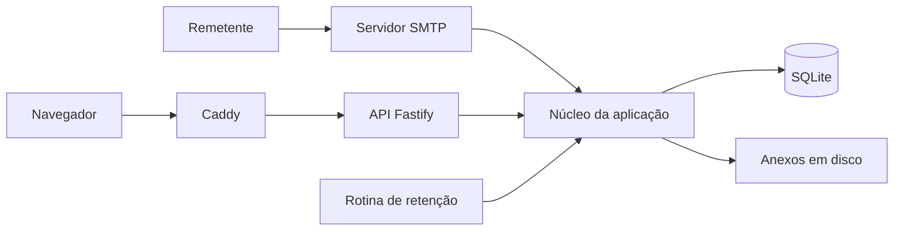

# TempMail

**Um serviço de e-mail descartável hospedado na sua própria infraestrutura.**

O TempMail reúne recepção SMTP, API HTTP e uma interface web para criar caixas temporárias e acompanhar mensagens recebidas. O backend gerencia mensagens e anexos, aplica retenção e acompanha o estado do armazenamento.

[Visão geral](#visão-geral) · [Arquitetura](#arquitetura) · [Executar](#executar-localmente) · [Verificações](#verificações) · [Operação](#operação)

## Visão geral

| Componente | Função |
| --- | --- |
| Caixas temporárias | Criação de endereços descartáveis pela aplicação. |
| SMTP | Recepção das mensagens destinadas ao domínio configurado. |
| Interface web | Leitura das mensagens e atualização por eventos do servidor. |
| Anexos | Armazenamento separado dos metadados da caixa. |
| Retenção | Limpeza por políticas de inatividade e duração máxima. |
| Operação | Logs estruturados, endpoint `/healthz` e bloqueio de recepção conforme o estado de disco. |

Utilize caixas descartáveis para testes e comunicações temporárias. Não as trate como arquivo permanente nem use dados sensíveis em demonstrações.

## Arquitetura



O [ponto de entrada](src/main.ts) valida a configuração, abre o SQLite, compõe os repositórios, inicia HTTP/SMTP e agenda a limpeza. As migrações são aplicadas ao abrir o banco. O encerramento fecha os recursos com uma janela de tolerância.

**Backend:** Node.js 22 — o manifesto aceita `>=22.0.0 <23` —, TypeScript, Fastify, SQLite, `smtp-server`, MailParser e Pino. A interface web tem seu próprio diretório e build.

## Executar localmente

Prepare Git, Node.js 22, npm e Docker com Compose compatível com a configuração `!override` utilizada no arquivo local.

```bash
git clone https://github.com/dlr-1337/tempmail.git
cd tempmail
cp .env.example .env
```

No `.env`, configure `DOMAIN=tempmail.local`, `TLS_DEV_SELF_SIGNED=true`, `LETS_ENCRYPT_EMAIL=dev@tempmail.local` e valores próprios para `PII_LOG_SALT` e `COOKIE_SECRET`. Cada segredo pode ser gerado separadamente com `openssl rand -hex 32`; não deixe placeholders literais nem publique os valores.

Adicione **uma única vez** a entrada `127.0.0.1 tempmail.local` ao arquivo hosts da máquina. Em seguida, compile o frontend e inicie a composição local:

```bash
cd web
npm ci
npm run build
cd ..
docker compose -f docker-compose.yml -f docker-compose.local.yml up --build
```

Abra **https://tempmail.local/**. O ambiente utiliza a autoridade certificadora local do Caddy; configure a confiança dessa CA na máquina de desenvolvimento. O SMTP local é publicado na porta **2525**, não na porta de produção 25.

O build `web/build` é montado no Caddy. Compilar apenas o backend não prepara a interface. O passo a passo completo e a execução sem contêiner estão em [ops/DEV.md](ops/DEV.md).

## Verificações

Na raiz, com as dependências de desenvolvimento instaladas:

```bash
npm ci
npm run typecheck
npm run check
npm test
npm run build
```

Há roteiros de smoke test em `ops/smoke-test.sh` e `ops/smoke-test.ps1`. Leia o guia antes de executá-los: eles iniciam e encerram a pilha de teste.

Para parar a composição preservando os volumes:

```bash
docker compose -f docker-compose.yml -f docker-compose.local.yml down
```

Não acrescente `-v` a esse comando quando precisar conservar os dados persistidos.

## Organização

- [src/main.ts](src/main.ts): composição dos serviços e ciclo de vida.
- `src/http/` e `src/smtp/`: interfaces HTTP e SMTP.
- `src/core/`, `src/db/` e `src/attachments/`: regras e armazenamento.
- `src/sweeper/`: retenção e estado de disco.
- `web/`: aplicação de navegador.
- `ops/`: configuração e roteiros operacionais.
- `tests/`: verificações dos componentes.

## Operação

O ambiente local não comprova recepção de e-mails vindos da internet. Uma implantação pública exige domínio, DNS, acesso SMTP, TLS e controles operacionais adequados à infraestrutura escolhida. As configurações locais de certificado e portas não devem ser copiadas como configuração de produção.

Mantenha segredos, conteúdo das caixas e anexos fora do Git. Verifique retenção e espaço disponível antes de aceitar mensagens reais; dados temporários podem ser removidos pelas políticas da aplicação.
